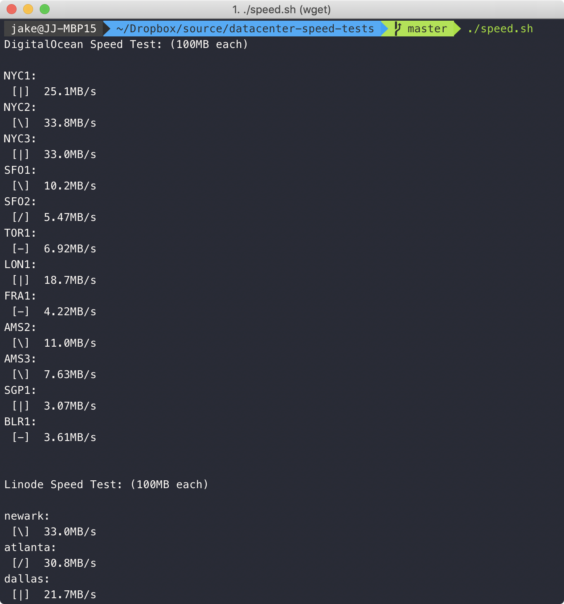
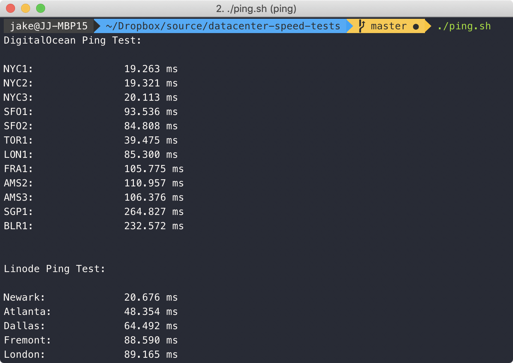

# Speed & Ping Tests for Cloud Hosting Providers

## Notes

- Speed tests for ***each region of each provider*** (there are over 80) can use **up to 100MB of data**. Be careful if your ISP caps your data usage!
- Files are downloaded via HTTP (not HTTPS) to get pure speed without encryption overhead.
- Tests can always be influenced by outside variables. Run the scripts multiple times if you want to ensure accuracy. Evil throttling ISPs can mess up the results too, of course.
- If it looks like the script has crashed, the current test is probably just taking a while — especially when testing far-away regions. If you already know that testing other continents is futile, just remove them from the for loops in `speed.sh`.
- **Note:** The scripts for DigitalOcean, Linode, and Vultr may be out of date. I was unable to access their websites to get the latest information.

## Usage

**Security Note:** These scripts download and execute code from the internet. You should always review scripts from the internet before running them.

If you trust me (which you shouldn't, _please_ don't trust random people on the internet!) these commands will download and run the scripts automatically:

```
wget -qO - https://raw.githubusercontent.com/arbal/datacenter-speed-tests/master/ping.sh | bash
wget -qO - https://raw.githubusercontent.com/arbal/datacenter-speed-tests/master/speed.sh | bash
```

Or, clone the repository and make sure the scripts are executable before running:

```
git clone https://github.com/arbal/datacenter-speed-tests.git
cd datacenter-speed-tests
chmod +x ping.sh && chmod +x speed.sh
./ping.sh
./speed.sh
```

## Providers & Regions

Scripts will test speed and pings to the following data centers:

#### [DigitalOcean](https://www.digitalocean.com/docs/platform/availability-matrix/#datacenter-regions)

- NYC1
- NYC2
- NYC3
- SFO1
- SFO2
- SFO3
- TOR1
- LON1
- FRA1
- AMS2
- AMS3
- SGP1
- BLR1

#### [Linode](https://www.linode.com/global-infrastructure/)

- Newark
- Atlanta
- Dallas
- Fremont
- London
- Frankfurt
- Singapore
- Tokyo
- Sydney
- Toronto
- Mumbai

#### [Amazon Web Services](https://docs.aws.amazon.com/AmazonRDS/latest/UserGuide/Concepts.RegionsAndAvailabilityZones.html)

**Note:** The speed test for AWS is currently not working.

- us-east-1
- us-east-2
- us-west-1
- us-west-2
- af-south-1
- ap-east-1
- ap-south-2
- ap-southeast-3
- ap-southeast-5
- ap-southeast-4
- ap-south-1
- ap-northeast-3
- ap-northeast-2
- ap-southeast-1
- ap-southeast-2
- ap-east-2
- ap-southeast-7
- ap-northeast-1
- ca-central-1
- ca-west-1
- eu-central-1
- eu-west-1
- eu-west-2
- eu-south-1
- eu-west-3
- eu-south-2
- eu-north-1
- eu-central-2
- il-central-1
- mx-central-1
- me-south-1
- me-central-1
- sa-east-1

#### [Google Cloud](https://cloud.google.com/compute/docs/regions-zones/)

**Note:** The speed test for GCP is now using the [gcping](https://github.com/GoogleCloudPlatform/gcping) tool, which measures latency to Google Cloud Run services in each region.

- africa-south1
- asia-northeast1
- asia-south1
- asia-southeast1
- asia-southeast2
- europe-west3
- europe-west4
- europe-west6
- europe-west9
- us-central1
- us-east1
- us-east4
- us-east5
- us-south1
- us-west1

#### [Vultr/Choopa](https://www.vultr.com/features/datacenter-locations/)

- nj-us
- il-us
- ga-us
- fl-us
- tx-us
- sjo-ca-us
- lax-ca-us
- wa-us
- tor-ca
- fra-de
- ams-nl
- par-fr
- lon-gb
- syd-au
- sgp
- hnd-jp
- sel-kor

## Screenshots




---

Inspired by https://www.reddit.com/r/webdev/comments/6ylmki/heres_an_easy_way_to_find_the_nearest/
